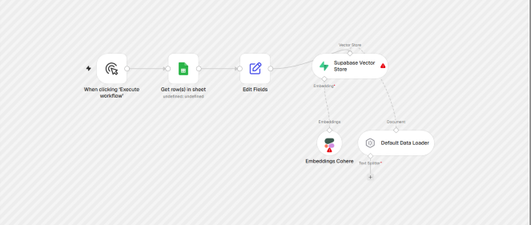
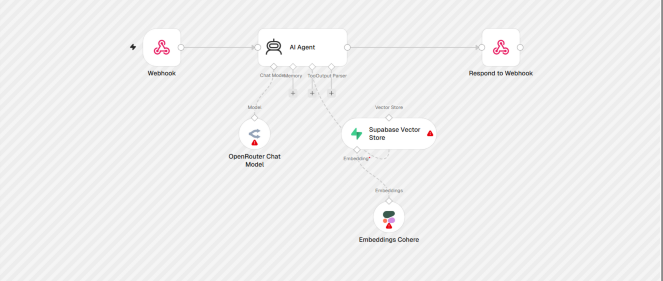
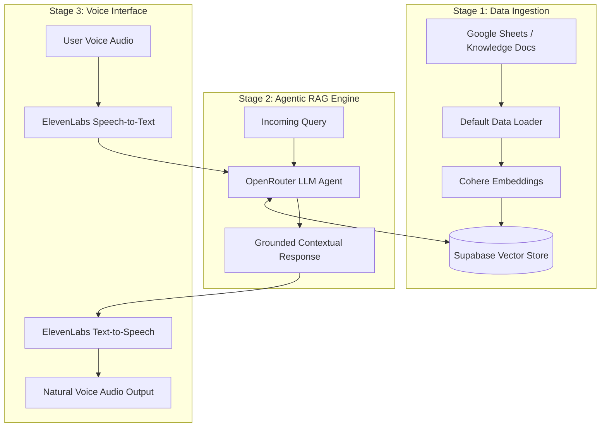

# Conversational Voice AI Agent with Vector RAG (n8n + ElevenLabs + Supabase)

An end-to-end multimodal voice assistant built with n8n. It allows users to ask questions over voice, retrieves accurate answers from an enterprise knowledge base stored in a Supabase Vector database, and responds naturally in human speech using ElevenLabs.

---

## The Problem It Solves

Traditional voice bots and IVR systems are rigid, scripted, and frustrating to talk to. Meanwhile, typical text-only chatbots cannot handle natural voice conversations. 

I built this system to bridge both worlds:
1. **Dynamic Knowledge:** Instead of hardcoded replies, it answers questions directly from real documents using semantic vector search (RAG).
2. **True Voice Interaction:** Users talk naturally to the agent, and it answers back in realistic, human-quality audio rather than a robotic voice.

---

## System Architecture

### 1. Data Ingestion Pipeline (Google Sheets ➔ Cohere ➔ Supabase Vector DB)



### 2. Agentic Vector RAG Retrieval Engine (OpenRouter + Supabase + Webhook)



### Multimodal Pipeline Flow



---

## The 3 Workflows in this Repository

### 1. Data Ingestion Pipeline (`workflows/01_data_ingest_pipeline.json`)
- Reads raw company information and FAQs from Google Sheets.
- Passes content through a document loader and text formatter.
- Generates high-dimensional vector embeddings using **Cohere Embeddings**.
- Stores and indexes the vectors directly into **Supabase (pgvector)**.

### 2. Agentic RAG Engine (`workflows/02_agentic_rag_retrieval.json`)
- Receives queries via Webhook.
- Uses an **AI Agent node (powered by OpenRouter)** to understand user intent.
- Queries the **Supabase Vector Store** to retrieve the most relevant knowledge chunks.
- Formulates accurate, grounded answers without hallucinating facts.

### 3. Audio Voice Agent (`workflows/03_audio_voice_agent_elevenlabs.json`)
- Accepts audio file input or voice streams through a Webhook trigger.
- Transcribes spoken audio into text using **ElevenLabs Speech-to-Text (STT)**.
- Hands the transcribed question to the reasoning agent.
- Converts the final response back into natural human speech using **ElevenLabs Text-to-Speech (TTS)**.
- Sends the audio back to the user with low latency.

---

## Tech Stack & Integrations

- **Orchestration:** [n8n](https://n8n.io/)
- **Voice Intelligence:** ElevenLabs (Speech-to-Text & Text-to-Speech)
- **Vector Database:** Supabase (`pgvector`)
- **Embedding Model:** Cohere Embeddings (`embed-english-v3.0` / multilingual)
- **Language Model:** OpenRouter (OpenAI / Anthropic models via LangChain agent node)
- **Source Data:** Google Sheets API

---

## How to Set It Up

### 1. Clone the Repository
```bash
git clone https://github.com/MUNEEBJAVAID/conversational-voice-agent-with-rag.git
cd conversational-voice-agent-with-rag
```

### 2. Import into n8n
Import the three workflow JSON files from the `workflows/` directory in sequence:
1. `01_data_ingest_pipeline.json`
2. `02_agentic_rag_retrieval.json`
3. `03_audio_voice_agent_elevenlabs.json`

### 3. Add Credentials
Configure the following connections in your n8n credentials panel:
- **ElevenLabs API Key** (for STT and voice synthesis)
- **Supabase Credentials** (Database URL & Service Role Key for Vector Store)
- **Cohere API Key** (for generating embeddings)
- **OpenRouter API Key** (for LLM reasoning)
- **Google Sheets OAuth2** (for the data ingestion source)

### 4. Run the Pipeline
1. Run **Workflow 1** once to populate your Supabase vector store with knowledge data.
2. Test **Workflow 2** with sample questions to verify semantic retrieval.
3. Call **Workflow 3** with a test audio clip to receive a synthesized voice reply!

---

## What I Learned Building This

- **Audio Latency & Pipeline Flow:** Passing audio between webhooks, transcription, LLMs, and voice synthesis requires keeping payload sizes compact to minimize user wait times.
- **RAG Chunking & Retrieval Quality:** Accurate vector search depends heavily on how cleanly data is formatted before running it through Cohere embeddings into Supabase.
- **Modular Design:** Splitting ingestion, retrieval, and voice handling into distinct workflows makes the system easy to debug, scale, and maintain independently.

---

## License
MIT License - feel free to use and adapt this project for your own automations.
